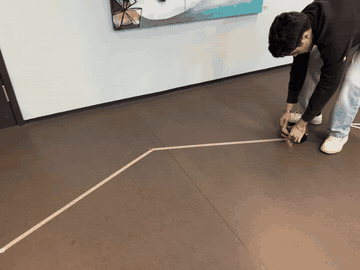
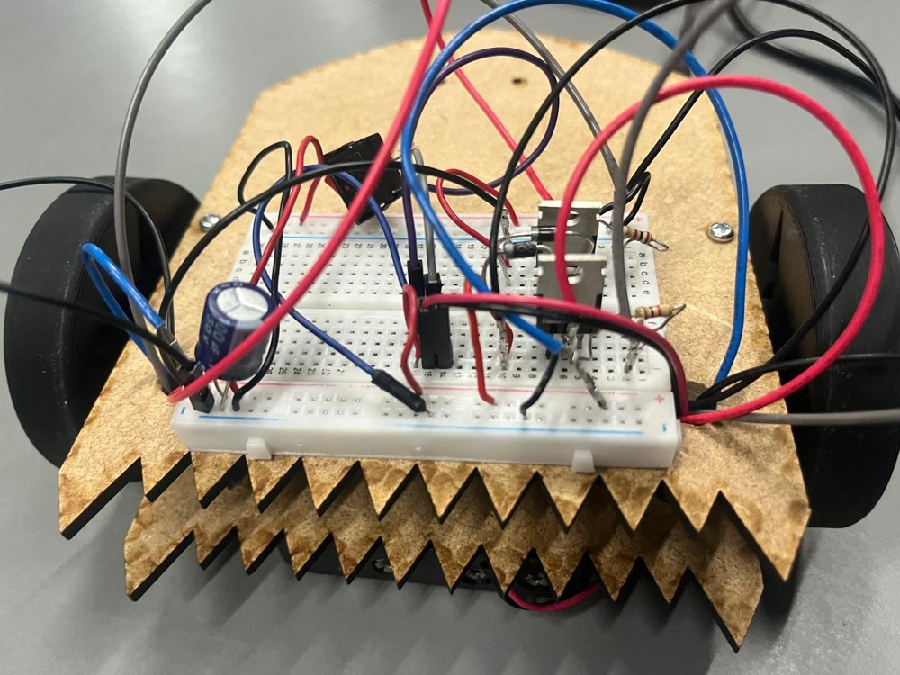

# Line-Following Robot

An Arduino robot that follows a line on the floor using two IR sensors and two DC motors.
Built for the *How to Make (Almost) Anything* course at the IT University of Copenhagen (2026).

<p align="center">
  
</p>

## How it works

Two FC-51 infrared sensors sit on either side of the line. When one of them detects the line, the robot steers towards that side:

- **Soft correction:** the inner wheel slows down. This keeps small drifts on a straight path smooth.
- **Hard turn:** if the sensor stays on the line for more than 150 ms, it is a real curve, so the inner wheel stops completely.

Other details in the firmware:

- **Soft start:** motor PWM ramps up gradually, avoiding current peaks that drop the battery voltage and reset the Arduino.
- **Motor trim:** compensates for the two motors not spinning at exactly the same speed.
- **Configurable line colour:** works with a white line on a dark floor or a black line on a light floor.

## Hardware

| Component | Role |
|---|---|
| Arduino | Controller |
| 2 × FC-51 IR sensors | Line detection (active-low) |
| 2 × DC motors | Drive wheels |
| 2 × FQP30N06L logic-level MOSFETs | Low-side motor switches, driven by PWM through 1 kΩ gate resistors |
| 2 × 1N4001 diodes | Flyback protection across each motor |

<p align="center">
  
</p>

## Project structure

```
line_follower/
  line_follower.ino   firmware (Arduino C++)
images/
  demo.gif            robot on the track
  robot.jpg           the circuit on the chassis
```

## Running it

1. Open `line_follower/line_follower.ino` in the Arduino IDE.
2. Set `WHITE_LINE` to match your track, and adjust `LEFT_TRIM` / `RIGHT_TRIM` if the robot drifts.
3. Upload to the board.

## Tech

Arduino (C++) · PWM motor control · MOSFET drivers · IR sensing · Fritzing
